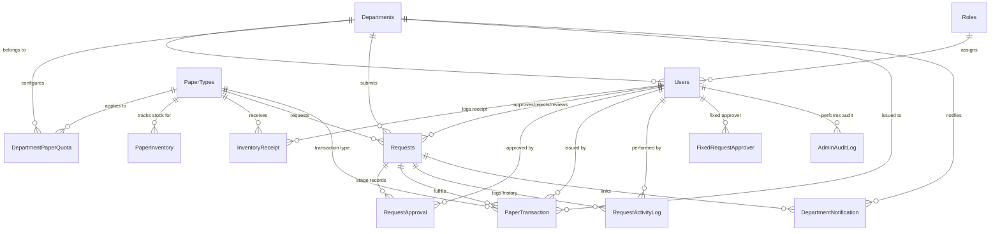

# Database Specialist Analysis & Outcomes Report
**Project Name:** Paper Bundle Distribution Management System (v12)  
**Target Database:** SQL Server 2019 / 2022 (`PaperDb`)  
**Application Stack:** ASP.NET Core 9 MVC (`Resource Management System`)  
**Data Access Method:** ADO.NET Stored Procedure Pattern (`DbHelper.cs`)  
**Analysis Date:** August 30, 2026  

---

## 1. Executive Summary

As a Database Specialist, a comprehensive analysis of the **Paper Bundle Distribution Management System (v12)** codebase was performed. The analysis covered the **SQL Database Schema (`ScriptV12.sql`)**, **49 Stored Procedures**, the **C# ADO.NET Data Access Layer (`DbHelper.cs`, `RequestController.cs`)**, and **System Specification Documents (`.docx`)**.

### Overall System Assessment
The database is structured to support a high-integrity enterprise paper management and quota tracking workflow. It includes **15 tables**, **23 Foreign Key constraints**, and **49 stored procedures**. Key architectural strengths include **pessimistic locking (`UPDLOCK, HOLDLOCK`)** for stock and quota concurrency control, **idempotent request submissions (`SubmissionKey` GUIDs)**, and **100% parameterized stored procedure calls**, which eliminate SQL injection vulnerabilities.

However, critical database performance, maintenance, and consistency risks were identified:
1. **Zero Non-Clustered Indexes (Critical Performance Bottleneck):** There are **0 non-clustered indexes** in the entire database. Every foreign key join and search filter (`DepartmentID`, `PaperTypeID`, `Status`, `SubmissionKey`, `RequestDate`) performs a **Full Table Scan**, which will degrade system performance as data grows.
2. **Data Type Inconsistency (`datetime` vs `datetime2(7)`):** High-volume transaction tables mix legacy 3.33ms `datetime` with high-precision `datetime2(7)`, causing implicit conversions and potential date boundary edge cases.
3. **Lack of Structured Error Handling (`BEGIN TRY ... CATCH`):** While `SET XACT_ABORT ON` is enabled, 0 stored procedures use explicit `TRY...CATCH` blocks for error logging or custom error responses.
4. **Schema Redundancy:** `Departments.DepartmentQuota` exists alongside the composite `DepartmentPaperQuota` table, leading to potential data drift.

---

## 2. Entity Relationship & Schema Architecture

### Entity Relationship Diagram (ERD)
The database models 5 primary business domains: **User & Auth**, **Department & Quota**, **Paper Inventory**, **Request & Approval Workflow**, and **Audit & Notifications**.



### Table Breakdown & Storage Footprint

| Table Name | Primary Key | Foreign Keys | Key Purpose | Optimization Status |
| :--- | :--- | :--- | :--- | :--- |
| **`Users`** | `UserID` (Int, Identity) | `RoleID`, `DepartmentID` | Authentication, security stamp, user state | ⚠️ Missing index on `RoleID`, `DepartmentID`, `UserName` |
| **`Roles`** | `RoleID` (Int, Identity) | None | Access control (Admin, Approver, DeptUser, etc.) | ✅ Static reference table |
| **`Departments`** | `DepartmentID` (Int, Identity) | None | Department master list | ⚠️ Deprecated `DepartmentQuota` column present |
| **`PaperTypes`** | `PaperTypeID` (Int, Identity) | None | Paper catalog and low-stock threshold | ✅ Static reference table |
| **`DepartmentPaperQuota`** | `(DepartmentID, PaperTypeID)` | `DepartmentID`, `PaperTypeID` | Per-department, per-paper-type quota limits | ✅ Composite Primary Key automatically creates clustered index |
| **`PaperInventory`** | `PaperTypeID` (Int) | `PaperTypeID` | Current physical stock and total received balance | ⚠️ Stateful table; needs verification view vs transactions |
| **`InventoryReceipt`** | `ReceiptID` (Int, Identity) | `PaperTypeID`, `ReceivedBY` | Inbound paper stock logs | ⚠️ Missing index on `PaperTypeID`, `ReceivedDate` |
| **`Requests`** | `RequestID` (Int, Identity) | `DepartmentID`, `PaperTypeID`, `ApprovedBY`, `RejectedBY`, `ITReviewedBy` | Core transaction table for paper requests | 🔴 **CRITICAL**: Missing indexes on `DepartmentID`, `PaperTypeID`, `Status`, `SubmissionKey`, `RequestDate` |
| **`RequestApproval`** | `ApprovalID` (Int, Identity) | `RequestID`, `ApprovedBy` | Approver stage workflow history | ⚠️ Missing index on `RequestID`, `ApprovalStage` |
| **`PaperTransaction`** | `TransactionID` (Int, Identity) | `RequestID`, `DepartmentID`, `PaperTypeID`, `IssuedBY` | Outbound stock fulfillment ledger | ⚠️ Missing index on `DepartmentID`, `PaperTypeID`, `IssueDate` |
| **`RequestActivityLog`** | `LogID` (Int, Identity) | `RequestID`, `PerformedBy` | Timeline audit log for request state changes | ⚠️ Missing index on `RequestID` |
| **`DepartmentNotification`** | `NotificationID` (Int, Identity) | `DepartmentID`, `RequestID` | Notification inbox per department | ⚠️ Missing index on `(DepartmentID, SeenDate)` |
| **`FixedRequestApprover`**| `ApprovalStage` (TinyInt) | `UserID` | Stage 1 and Stage 2 fixed approver mappings | ✅ Clustered PK on Stage |
| **`AdminAuditLog`** | `AuditID` (BigInt, Identity)| `PerformedByUserID` | Administrative audit trail | ⚠️ Missing index on `CreatedUtc`, `ActionType` |
| **`SystemMigrationHistory`**| `MigrationKey` (nvarchar(150))| None | Schema migration tracking | ✅ Small table |

---

## 3. Stored Procedure & Transaction Logic Evaluation

The project implements **49 Stored Procedures**. The logic inside core procedures was evaluated for locking, isolation, atomicity, and exception resilience:

### A. Stock & Quota Concurrency Control (`sp_SubmitRequest`, `sp_IssueRequest`)
- **Pessimistic Locking:** Both `sp_SubmitRequest` and `sp_IssueRequest` explicitly specify `WITH (UPDLOCK, HOLDLOCK)` (Serializable Update Locks).
- **Concurrency Protection:** This prevents two concurrent users from reading the same remaining quota or physical stock and over-allocating paper.
- **Idempotency via `SubmissionKey`:** `sp_SubmitRequest` and `sp_SubmitExceptionRequest` check `WHERE SubmissionKey = @SubmissionKey` under lock before processing. If a user double-clicks or retries a request, the existing `RequestID` is returned instantly without duplicate record creation.

### B. Stock Deduction Atomic Update (`sp_IssueRequest`)
```sql
UPDATE dbo.PaperInventory
SET CurrentStock = CurrentStock - @Qty,
    LastUpdated = SYSUTCDATETIME()
WHERE PaperTypeID = @PaperTypeID AND CurrentStock >= @Qty;

IF @@ROWCOUNT = 0
BEGIN
    ROLLBACK TRANSACTION;
    THROW 51013, 'Insufficient physical stock to issue this request.', 1;
END
```
- **Evaluation:** The atomic `UPDATE ... WHERE CurrentStock >= @Qty` combined with `@@ROWCOUNT` validation ensures physical stock cannot drop below zero under concurrent issue operations.

### C. Exception Handling Gap (`BEGIN TRY ... BEGIN CATCH`)
- **Finding:** `BEGIN TRY ... BEGIN CATCH` blocks are **0 across all 49 procedures**.
- **Impact:** Procedures rely exclusively on `SET XACT_ABORT ON;`. While `XACT_ABORT ON` automatically rolls back transactions on severity 16+ errors, client applications receive unhandled SQL exception numbers (e.g. `THROW 51001`) without structured error detail logging or clean execution state wrapping inside SQL Server error logs.

---

## 4. Performance & Indexing Analysis

### Critical Bottleneck: 0 Non-Clustered Indexes
In SQL Server, creating a Foreign Key constraint does **not** automatically create an index on the referencing column. 

When executing `sp_GetFilteredRequests`:
```sql
SELECT r.RequestID, r.DepartmentID, d.DepartmentName, ...
FROM dbo.Requests r
JOIN dbo.Departments d ON d.DepartmentID = r.DepartmentID
WHERE (@DepartmentID IS NULL OR r.DepartmentID = @DepartmentID)
  AND (@Status IS NULL OR r.Status = @Status)
  AND (@FromDate IS NULL OR r.RequestDate >= @FromDate)
```
SQL Server is forced to perform a **Clustered Index Scan (Table Scan)** over all rows in `Requests` because no non-clustered indexes exist on `DepartmentID`, `Status`, or `RequestDate`.

### High-Impact Missing Indexes

1. **`dbo.Requests` (Idempotency Lookup):**  
   - `SubmissionKey` is queried on *every request submission*. A non-clustered index on `SubmissionKey` reduces lookup cost from $O(N)$ to $O(\log N)$.
2. **`dbo.Requests` (Queue & Filter Lookups):**  
   - Queries filtering by `(DepartmentID, Status)`, `(PaperTypeID, Status)`, or `(Status, RequestDate)`.
3. **`dbo.DepartmentNotification` (Inbox Polling):**  
   - Queries filtering by `DepartmentID` where `SeenDate IS NULL`.
4. **`dbo.PaperTransaction` (Usage & Pivot Reports):**  
   - Aggregations grouped by `DepartmentID`, `PaperTypeID`, and date ranges.
5. **`dbo.Users` (Login & Auth Validation):**  
   - Queries filtering by `UserName` or `(DepartmentID, IsActive)`.

---

## 5. C# Data Access Layer & Security Audit

### ADO.NET `DbHelper.cs` Review
```csharp
public DataTable ExecuteQuery(string procName, params SqlParameter[] parameters)
{
    using var conn = new SqlConnection(_connectionString);
    using var cmd = new SqlCommand(procName, conn) { CommandType = CommandType.StoredProcedure };
    if (parameters != null && parameters.Length > 0)
    {
        cmd.Parameters.AddRange(parameters);
    }
    var table = new DataTable();
    conn.Open();
    using var adapter = new SqlDataAdapter(cmd);
    adapter.Fill(table);
    return table;
}
```
- ✅ **100% Parameterized Execution:** All SQL parameters are explicitly mapped using `SqlParameter`. No dynamic SQL string building is performed.
- ✅ **Connection Pooling Compliance:** `using var conn` guarantees connections are disposed and returned to the ADO.NET connection pool immediately.
- ✅ **Layer Separation:** Controllers interact strictly via `DbHelper` methods without inline T-SQL statements.

### Security & Password Audit
- `Users.PasswordHash` is defined as `nvarchar(256)`. Passwords are hashed using ASP.NET Core Identity's `PasswordHasher<T>` (PBKDF2 / HMAC-SHA256).
- `Users.AuthenticationVersion` (`bigint`) is refreshed upon password change or administrative action, instantly invalidating active cookie sessions via `CookieSessionValidationEvents.cs`.

---

## 6. Recommended Remediation & Enhancements

To upgrade the database to enterprise production readiness, the following SQL script packages are recommended:

### Remediation Script 1: Optimal Non-Clustered Indexes Package
Run the script below to resolve the indexing deficit:

```sql
USE [PaperDb];
GO

-- 1. Idempotency Index for Requests
CREATE NONCLUSTERED INDEX [IX_Requests_SubmissionKey]
ON [dbo].[Requests] ([SubmissionKey])
INCLUDE ([RequestID]);
GO

-- 2. Filtering & Queue Index for Requests
CREATE NONCLUSTERED INDEX [IX_Requests_Dept_Status_Date]
ON [dbo].[Requests] ([DepartmentID], [Status], [RequestDate])
INCLUDE ([PaperTypeID], [RequestedQuantity], [IsException]);
GO

-- 3. Status & Approver Filtering Index
CREATE NONCLUSTERED INDEX [IX_Requests_Status_ApprovedBY]
ON [dbo].[Requests] ([Status], [ApprovedBY])
INCLUDE ([RequestID], [DepartmentID], [PaperTypeID]);
GO

-- 4. Notification Inbox Index
CREATE NONCLUSTERED INDEX [IX_DepartmentNotification_Dept_Seen]
ON [dbo].[DepartmentNotification] ([DepartmentID], [SeenDate])
INCLUDE ([NotificationID], [RequestID], [Message], [CreatedDate]);
GO

-- 5. Paper Transaction Reporting Index
CREATE NONCLUSTERED INDEX [IX_PaperTransaction_Dept_Paper_Date]
ON [dbo].[PaperTransaction] ([DepartmentID], [PaperTypeID], [IssueDate])
INCLUDE ([QuantityIssued], [RequestID]);
GO

-- 6. User Login Lookup Index
CREATE UNIQUE NONCLUSTERED INDEX [IX_Users_UserName]
ON [dbo].[Users] ([UserName])
INCLUDE ([UserID], [PasswordHash], [RoleID], [DepartmentID], [IsActive], [AuthenticationVersion]);
GO

-- 7. Request Activity Log Lookup
CREATE NONCLUSTERED INDEX [IX_RequestActivityLog_RequestID]
ON [dbo].[RequestActivityLog] ([RequestID], [CreatedDate])
INCLUDE ([EventType], [PerformedBy], [Quantity]);
GO
```

### Remediation Script 2: Inventory Ledger Consistency View
Create a database view to verify `PaperInventory` physical stock against raw `InventoryReceipt` and `PaperTransaction` logs:

```sql
USE [PaperDb];
GO

CREATE VIEW [dbo].[vw_PaperStockReconciliation]
AS
SELECT 
    pt.PaperTypeID,
    pt.PaperTypeName,
    ISNULL(r.TotalReceivedLogs, 0) AS TotalReceivedFromReceipts,
    ISNULL(t.TotalIssuedLogs, 0) AS TotalIssuedFromTransactions,
    (ISNULL(r.TotalReceivedLogs, 0) - ISNULL(t.TotalIssuedLogs, 0)) AS CalculatedCurrentStock,
    pi.CurrentStock AS InventoryTableCurrentStock,
    CASE 
        WHEN (ISNULL(r.TotalReceivedLogs, 0) - ISNULL(t.TotalIssuedLogs, 0)) = pi.CurrentStock 
        THEN 'IN_SYNC' 
        ELSE 'DISCREPANCY_DETECTED' 
    END AS StockStatus
FROM dbo.PaperTypes pt
LEFT JOIN dbo.PaperInventory pi ON pi.PaperTypeID = pt.PaperTypeID
LEFT JOIN (
    SELECT PaperTypeID, SUM(QuantityReceived) AS TotalReceivedLogs
    FROM dbo.InventoryReceipt
    GROUP BY PaperTypeID
) r ON r.PaperTypeID = pt.PaperTypeID
LEFT JOIN (
    SELECT PaperTypeID, SUM(QuantityIssued) AS TotalIssuedLogs
    FROM dbo.PaperTransaction
    GROUP BY PaperTypeID
) t ON t.PaperTypeID = pt.PaperTypeID;
GO
```

### Remediation Script 3: Standardized Stored Procedure Template with TRY/CATCH
Update stored procedures to follow a standardized exception handling structure:

```sql
CREATE PROCEDURE [dbo].[sp_Template_StandardProcedure]
    @Param1 INT,
    @PerformedByUserID INT
AS
BEGIN
    SET NOCOUNT ON;
    SET XACT_ABORT ON;

    BEGIN TRY
        BEGIN TRANSACTION;

        -- Business Logic Here

        COMMIT TRANSACTION;
    END TRY
    BEGIN CATCH
        IF @@TRANCOUNT > 0
            ROLLBACK TRANSACTION;

        DECLARE @ErrorMessage NVARCHAR(4000) = ERROR_MESSAGE();
        DECLARE @ErrorSeverity INT = ERROR_SEVERITY();
        DECLARE @ErrorState INT = ERROR_STATE();

        RAISERROR(@ErrorMessage, @ErrorSeverity, @ErrorState);
    END CATCH
END;
GO
```

---

## 7. Summary Checklist & Outcomes Table

| Metric / Feature | Current State | Recommendation | Severity / Priority |
| :--- | :--- | :--- | :--- |
| **SQL Injection Risk** | 0 Risk (100% Parameterized SPs) | Retain ADO.NET Stored Procedure Pattern | ✅ Low / Optimal |
| **Concurrency Protection** | Robust (`UPDLOCK, HOLDLOCK` serializable locks) | Retain explicit locking in critical updates | ✅ Optimal |
| **Submission Idempotency**| Enabled via `SubmissionKey` GUID | Add `IX_Requests_SubmissionKey` non-clustered index | 🔴 High |
| **Query Performance** | **0 Non-Clustered Indexes** | Apply Remediation Script 1 | 🔴 **CRITICAL** |
| **Data Types** | Mixed `datetime` & `datetime2(7)` | Standardize timestamp fields to `datetime2(7)` | 🟡 Medium |
| **Stock Audit Integrity** | Stateful `PaperInventory` table | Deploy `vw_PaperStockReconciliation` view | 🟡 Medium |
| **Error Propagation** | Relying solely on `XACT_ABORT` | Integrate `BEGIN TRY ... BEGIN CATCH` blocks | 🟡 Medium |
| **Schema Normalization** | Duplicate `Departments.DepartmentQuota` | Mark legacy column as deprecated / remove | 🟢 Low |

---
*Report compiled by Database Specialist AI Agent for Project System (Paper Management) v12.*
