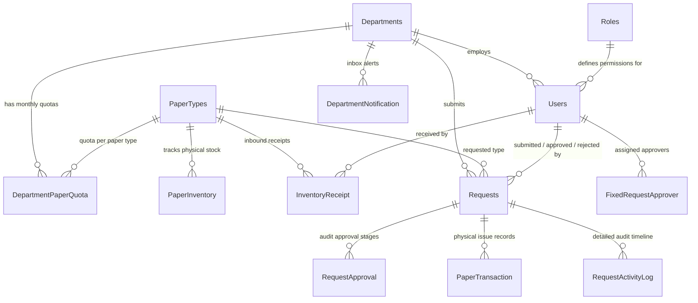

# Resource Management System (نظام إدارة الموارد - إدارة مخزون الورق)
## Comprehensive Technical Context, Architecture & AI Continuation Guide (v16)

> **Purpose**: This document is an all-inclusive, self-contained technical blueprint, architecture guide, and operational manual. If you hit your token or quota limit on any AI platform (Claude, Gemini, ChatGPT, Antigravity), **copy and paste this file into the new session** as your initial context prompt. Any LLM will immediately understand the full codebase, database schemas, business rules, security models, workflows, and current task backlog to continue development without missing a beat.

---

## 📑 Table of Contents
1. [AI Continuation Prompt (Copy & Paste Ready)](#1-ai-continuation-prompt)
2. [Project Identity & Tech Stack](#2-project-identity--tech-stack)
3. [Architecture & Solution Structure](#3-architecture--solution-structure)
4. [Database Design & SQL Server 2014 Specifications](#4-database-design--sql-server-2014-specifications)
5. [User Roles, Authentication & Permissions](#5-user-roles-authentication--permissions)
6. [Complete Request Lifecycle & Workflow State Machine](#6-complete-request-lifecycle--workflow-state-machine)
7. [Business Rules & Edge Case Validations](#7-business-rules--edge-case-validations)
8. [UI Components, Dashboards & Realtime Updates](#8-ui-components-dashboards--realtime-updates)
9. [Operational, Build & Debugging Commands](#9-operational-build--debugging-commands)
10. [Completed Milestones, Test Matrix & Roadmap](#10-completed-milestones-test-matrix--roadmap)

---

## 1. AI Continuation Prompt

```markdown
You are an expert Senior Full-Stack .NET & SQL Server Architect. 
You are continuing development on the "Resource Management System (Paper Management Subsystem - v16)".

KEY PROJECT FACTS:
- Framework: ASP.NET Core (.NET 10.0) MVC Architecture with Areas (Areas/PaperManagement)
- Language: C# 13 / .NET 10 (Nullable enabled, Implicit Usings)
- Database: Microsoft SQL Server 2014 Express / Developer (`Paper Managment`)
- Data Access: Pure ADO.NET with `Microsoft.Data.SqlClient` via `DbHelper.cs` (100% Stored Procedures, 0 Raw Dynamic SQL, Parameterized)
- Authentication: Cookie-based Authentication + BCrypt Password Hashing + Session Invalidation (`CookieSessionValidationEvents.cs`)
- Frontend: Tailwind CSS CDN, Cairo Arabic Font (RTL default), Bootstrap Icons, Chart.js, Vanilla JS + Server-Sent Events (SSE)
- Reporting & Excel: Custom zero-dependency OpenXML `.xlsx` generator (`SimpleXlsxWriter.cs`)
- Project Location: `C:\Users\h.Fathy\Desktop\project system (paper management) v16\Resource Management System`

CRITICAL SQL SERVER 2014 CONSTRAINTS:
1. NEVER use `CREATE OR ALTER PROCEDURE` (Unsupported in SQL Server 2014). Always use `IF OBJECT_ID('[dbo].[proc_name]', 'P') IS NOT NULL DROP PROCEDURE [dbo].[proc_name]; GO CREATE PROCEDURE...`.
2. NEVER use `FORMATMESSAGE` with string formatting arguments. Use standard T-SQL string concatenation (`+`).
3. Always store dates in UTC (`SYSUTCDATETIME()`) and use `dbo.fn_EgyptUtcToLocal` for Egyptian timezone rendering.
4. Department sorting must strictly follow `ORDER BY DepartmentID ASC` (1 to 48).
5. Always respect Pessimistic Locking (`WITH (UPDLOCK, HOLDLOCK)`) on inventory and quota updates.
6. All request submissions require the idempotency GUID parameter `@SubmissionKey`.

Your objective is to assist the user in writing bug-free, production-grade code, optimizing stored procedures, implementing requested UI/backend enhancements, and ensuring high code quality.
```

---

## 2. Project Identity & Tech Stack

| Attribute | Specification |
| :--- | :--- |
| **System Name** | Resource Management System (`نظام إدارة مخزون الموارد والورق`) |
| **Subsystem** | Paper Distribution & Inventory Management (`إدارة مخزون وتوزيع الورق`) |
| **Working Directory** | `C:\Users\h.Fathy\Desktop\project system (paper management) v16\Resource Management System` |
| **Target Framework** | `.NET 10.0` (`net10.0` Web SDK - LTS Supported until Nov 2028) |
| **Project Type** | ASP.NET Core MVC with Razor Views & Areas |
| **Database Engine** | Microsoft SQL Server 2014 Express / Enterprise |
| **Default Connection String**| `Server=.;Database=Paper Managment;Trusted_Connection=True;TrustServerCertificate=True;Encrypt=False;` |
| **Data Access Pattern** | Centralized ADO.NET Stored Procedure Adapter (`DbHelper.cs`) |
| **Password Hashing** | `BCrypt.Net-Next` (WorkFactor = 11) |
| **Realtime Engine** | Lightweight thread-safe Server-Sent Events (SSE) Hub (`QueueUpdateNotifier.cs`) |
| **Excel Export Engine** | Native OpenXML `.xlsx` Zip Stream Writer (`SimpleXlsxWriter.cs`) |
| **Hot Reload Package** | `Microsoft.AspNetCore.Mvc.Razor.RuntimeCompilation` (v10.0.11) |
| **UI Theme & Fonts** | Primary `#34435E`, Container `#58a4b0`, Surface `#FFFFFF`, Font: `Cairo` (RTL) |

---

## 3. Architecture & Solution Structure

```
C:\Users\h.Fathy\Desktop\project system (paper management) v16\
├── AI_CONTINUATION_GUIDE.md                     # This handover document
├── PROJECT_HANDOVER_GUIDE.md                    # Root handover guide
├── SUMMARY_OF_WORK_COMPLETED.md                 # Optimization & bug fix milestones
├── USERS_AND_PASSWORDS.md                       # Active test accounts & password reset queries
├── Bug_Analysis_SubmissionKey_Error.md          # Technical RCA for SubmissionKey idempotency
├── Database_Specialist_Analysis_Report.md       # Comprehensive database audit & indexing plan
├── ScriptV15.sql                                # Complete SQL Server 2014 database script
├── Resource Management System/
│   ├── Resource Management System.slnx          # Modern Visual Studio Solution File
│   └── Resource Management System/
│       ├── Resource Management System.csproj    # .NET 10 Web Project definition
│       ├── Program.cs                           # App startup, DI, Cookies, Routing, Antiforgery
│       ├── appsettings.json                     # Database connection strings & logging config
│       │
│       ├── Common/
│       │   ├── AppConstants.cs                  # Constants for Roles and RequestStatus
│       │   ├── PasswordHelper.cs                # BCrypt hashing & verification
│       │   └── StatusDisplayHelper.cs           # Arabic status labels and CSS badge mapping
│       │
│       ├── Controllers/                         # Root Portal Controllers
│       │   ├── AccountController.cs             # Login, ChangePassword, Session Handling
│       │   ├── HomeController.cs                # Portal root & module selector
│       │   └── UserManagementController.cs      # User CRUD, Role assignment, Password reset
│       │
│       ├── Areas/
│       │   └── PaperManagement/                 # Paper Management Area
│       │       ├── Controllers/
│       │       │   ├── RequestController.cs     # Main operational engine (Queues, Dashboard, Reports)
│       │       │   └── DepartmentManagementController.cs # Department quotas & fixed approvers
│       │       └── Views/
│       │           ├── Request/
│       │           │   ├── Index.cshtml                  # Admin / IT Main Dashboard & Analytics
│       │           │   ├── ApproverDashboard.cshtml      # Approver Dashboard (KPIs & Pending Queue)
│       │           │   ├── Create.cshtml                 # Department Normal Request form
│       │           │   ├── ExceptionRequest.cshtml       # Department Exception Request form
│       │           │   ├── MyRequests.cshtml             # Department user request history
│       │           │   ├── ReviewQueue.cshtml            # IT Review Queue (Stage 1 / Re-review)
│       │           │   ├── Pending.cshtml                # Approver Pending Queue (Stage 1 & 2)
│       │           │   ├── IssueQueue.cshtml             # IT Stock Issuing Queue
│       │           │   ├── History.cshtml                # Completed and historical requests log
│       │           │   ├── Inventory.cshtml              # Live stock, receipts, low stock threshold
│       │           │   ├── ReceiptLog.cshtml             # Stock receipt audit trail
│       │           │   ├── Reports.cshtml                # Multi-department consumption reports & Excel
│       │           │   ├── _ApproverDetailModal.cshtml   # Approver action modal (Approve/Reject)
│       │           │   └── _RequestDetailModal.cshtml    # IT & General review modal & timeline
│       │           └── Shared/
│       │               ├── _PaperLayout.cshtml           # Role-aware navigation layout
│       │               ├── _DashboardConsumptionChartsPartial.cshtml # Stacked bar consumption chart
│       │               ├── _DashboardReportFilterPartial.cshtml     # Advanced date & department filter
│       │               ├── _DashboardDepartmentDetailListPartial.cshtml # Accordion list with 3-color bar
│       │               ├── _RequestFilterPartial.cshtml  # Filter bar for history & queues
│       │               └── _ReviewQueueFilterPartial.cshtml # Filter bar for IT review queue
│       │
│       ├── Data/
│       │   └── DbHelper.cs                      # Central ADO.NET helper (ExecuteQuery, ExecuteNonQuery)
│       │
│       ├── Models/
│       │   ├── PaperRequestModels.cs            # ViewModels for Requests, Inventory, Dashboards, Reports
│       │   ├── NewRequestViewModel.cs           # Form binding for Create & Exception requests
│       │   ├── UserManagementModels.cs          # User CRUD, Role and Session ViewModels
│       │   └── LoginViewModel.cs                # Login credentials model
│       │
│       ├── Services/
│       │   ├── CookieSessionValidationEvents.cs # Validates `AuthenticationVersion` against DB on each request
│       │   ├── QueueUpdateNotifier.cs           # Real-time Server-Sent Events (SSE) notification broker
│       │   └── SimpleXlsxWriter.cs              # Pure C# native right-to-left Excel generator
│       │
│       └── wwwroot/                             # Static assets (Tailwind, Chart.js, custom JS/CSS)
```

---

## 4. Database Design & SQL Server 2014 Specifications

### A. Core Database Tables (15 Tables)



1. **`dbo.Departments`**: Master list of 48 organizational departments and sectors.
   - `DepartmentID` (INT PK Identity), `DepartmentName` (NVARCHAR(100)), `DepartmentGroup` (NVARCHAR(100)), `IsActive` (BIT).
2. **`dbo.PaperTypes`**: Paper catalog items (e.g., `A4`, `A3`).
   - `PaperTypeID` (INT PK Identity), `PaperTypeName` (NVARCHAR(50)), `LowStockThreshold` (INT).
3. **`dbo.DepartmentPaperQuota`**: Composite monthly quota configuration.
   - `DepartmentID` (INT FK), `PaperTypeID` (INT FK), `QuotaLimit` (INT), PK `(DepartmentID, PaperTypeID)`.
4. **`dbo.PaperInventory`**: Current physical stock ledger.
   - `PaperTypeID` (INT PK/FK), `CurrentStock` (INT), `TotalReceived` (INT), `LastUpdated` (DATETIME2).
5. **`dbo.InventoryReceipt`**: Audit trail of warehouse replenishment.
   - `ReceiptID` (INT PK Identity), `PaperTypeID` (INT FK), `QuantityReceived` (INT), `ReceivedDate` (DATETIME2), `ReceivedBY` (INT FK).
6. **`dbo.Requests`**: Central paper request entity.
   - `RequestID` (INT PK Identity), `DepartmentID` (INT FK), `PaperTypeID` (INT FK), `RequestedQuantity` (INT), `Status` (NVARCHAR(50)), `RequestDate` (DATETIME2), `IsException` (BIT), `SubmissionKey` (UNIQUEIDENTIFIER), `Notes`, `ITReviewNotes`, `ApproverOneNote`, `ApproverTwoNote`, `RejectionNote`, `IssueNotes`, timestamps and user FKs.
7. **`dbo.PaperTransaction`**: Ledger of physical stock deducted and dispensed to departments.
   - `TransactionID` (INT PK Identity), `RequestID` (INT FK), `DepartmentID` (INT FK), `PaperTypeID` (INT FK), `QuantityIssued` (INT), `IssueDate` (DATETIME2), `IssuedBY` (INT FK).
8. **`dbo.RequestActivityLog`**: Immutable timeline event log.
   - `LogID` (INT PK Identity), `RequestID` (INT FK), `EventType` (NVARCHAR(50)), `PerformedBy` (INT FK), `ActionDate` (DATETIME2), `Note` (NVARCHAR(MAX)), `Quantity` (INT).
9. **`dbo.FixedRequestApprover`**: Maps approval stages to specific system user IDs.
   - `ApprovalStage` (TINYINT PK: 1 = Vice President, 2 = General Manager), `UserID` (INT FK), `AssignedDate` (DATETIME2).
10. **`dbo.Users`**: System user accounts.
    - `UserID` (INT PK Identity), `UserName` (NVARCHAR(50) UNIQUE), `PasswordHash` (NVARCHAR(256)), `RoleID` (INT FK), `DepartmentID` (INT FK NULL), `IsActive` (BIT), `MustChangePassword` (BIT), `AuthenticationVersion` (BIGINT).
11. **`dbo.Roles`**: `Admin`, `IT`, `Approver`, `Department`.
12. **`dbo.DepartmentNotification`**: Department-specific notification messages.
13. **`dbo.AdminAuditLog`**: System administration audit trail.

---

### B. Complete Stored Procedure Catalog (58 Procedures in `ScriptV15.sql`)

| Category | Stored Procedure Name | Key Purpose & Parameters |
| :--- | :--- | :--- |
| **Submissions** | `sp_SubmitRequest` | Idempotent normal request creation with quota validation (`@SubmissionKey`, `@DepartmentID`, `@PaperTypeID`, `@RequestedQuantity`, `@Notes`, `@SubmittedByID`, `@NewRequestID OUTPUT`). |
| | `sp_SubmitExceptionRequest` | Idempotent exception request creation (requires remaining quota = 0). |
| **IT Actions** | `sp_ITReviewRequest` | IT approves request and forwards to Approver Stage 1 (`@RequestID`, `@ReviewerID`, `@ITReviewNotes`). |
| | `sp_RejectRequestByIT` | IT rejects request permanently (`@RequestID`, `@RejectorID`, `@Note`). |
| | `sp_ResendForApproval` | IT re-evaluates returned request and re-submits to Approver 1. |
| | `sp_FinalRejectRequest` | IT closes a returned request permanently after approver rejection. |
| | `sp_IssueRequest` | Dispenses paper, atomically decrements `PaperInventory.CurrentStock` under `UPDLOCK, HOLDLOCK`, records `PaperTransaction`, sets status to `Issued`. |
| **Approver Actions** | `sp_ApproveRequest` | Handles Approver 1 (advances to `PendingApproverTwo`) and Approver 2 (advances to `Approved`). |
| | `sp_RejectRequest` | Rejects request and returns it to IT as `PendingITReReview`. |
| | `sp_GetPendingRequestsForApprover` | Fetches pending requests for the logged-in approver stage. |
| | `sp_GetApproverDashboardStats` | KPI stats for Approver dashboard. |
| **Inventory** | `sp_ReceiveStock` | Increases stock balance and logs to `InventoryReceipt`. |
| | `sp_GetInventoryStatus` | Live snapshot of stock, thresholds, and totals. |
| | `sp_GetInventoryReceiptLog` | Inbound receipt history. |
| | `sp_UpdateLowStockThreshold` | Updates minimum stock warning limit per paper type. |
| **Dashboard & Reports**| `sp_GetDashboardStats` | Admin/IT KPI summary cards. |
| | `sp_GetDepartmentConsumptionSummary` | Aggregated consumption per department for A4, A3, and total. |
| | `sp_GetFilteredRequests` | Advanced search across status, department, dates, and keywords. |
| | `sp_GetUsageReport` | Usage matrix report partitioned by paper type. |
| | `sp_GetDepartmentLatestIssue` | Most recent issuance date per department. |
| **User & Department** | `sp_GetUserForLogin` | Retrieves credentials & role for login authentication. |
| | `sp_GetUserSessionState` | Checks `IsActive`, `MustChangePassword`, and `AuthenticationVersion`. |
| | `sp_ChangeOwnPassword` | User changes own password and increments `AuthenticationVersion`. |
| | `sp_CreateUser` / `sp_DeleteUser` | Admin user provisioning. |
| | `sp_GetDepartmentPaperQuotas` | Master department quota matrix. |
| | `sp_UpdateDepartmentPaperQuota`| Updates quota limit for a department/paper type pair. |
| | `sp_SetFixedRequestApprover` | Assigns UserID to ApprovalStage 1 or 2. |

---

## 5. User Roles, Authentication & Permissions

### A. Live System Accounts (from `USERS_AND_PASSWORDS.md`)

| UserID | Username | Role | Department / Assignment | Status | Initial Password |
| :---: | :--- | :--- | :--- | :---: | :--- |
| **3** | `ADMIN` | `Admin` | *System Admin* | ✅ Active | Configured |
| **21** | `IT` | `IT` | *IT Custodian / Storage* | ✅ Active | Configured |
| **4** | `DEAN` | `Approver` | *Approver Stage 1 (نائب رئيس الإدارة)* | ✅ Active | Configured |
| **7** | `DEAN2` | `Approver` | *Approver Stage 2 (مدير الإدارة)* | ✅ Active | Configured |
| **2** | `CAIRO` | `Department`| *القاهرة (Cairo)* | ✅ Active | Configured |
| **17** | `ASWAN` | `Department`| *اسوان (Aswan)* | ✅ Active | Configured |
| **1** | `CEO` | `Department`| *مكتب المدير العام* | ⚠️ Must Change Pass | Requires Change |

#### Password reset policy

Use the administrator password-reset function for one account at a time. Generate a unique temporary password and deliver it through an approved secure channel; do not keep shared passwords or password hashes in project files.

### B. Role Access Matrix

| Feature / URL Route | Admin | IT | Approver | Department |
| :--- | :---: | :---: | :---: | :---: |
| **Portal Home (`/Home/Index`)** | ✅ | ✅ | ✅ | ✅ |
| **Admin Dashboard (`/PaperManagement/Request/Index`)** | ✅ | ✅ | ❌ *(Redirects to Approver Dash)* | ❌ *(Redirects to Create)* |
| **Approver Dashboard (`/PaperManagement/Request/ApproverDashboard`)** | ✅ | ❌ | ✅ | ❌ |
| **Create Normal Request (`/PaperManagement/Request/Create`)** | ✅ | ✅ | ❌ | ✅ |
| **Create Exception Request (`/PaperManagement/Request/ExceptionRequest`)** | ✅ | ✅ | ❌ | ✅ |
| **My Requests History (`/PaperManagement/Request/MyRequests`)** | ✅ | ✅ | ❌ | ✅ |
| **IT Review Queue (`/PaperManagement/Request/ReviewQueue`)** | ✅ | ✅ | ❌ | ❌ |
| **Approver Pending Queue (`/PaperManagement/Request/Pending`)** | ✅ | ❌ | ✅ | ❌ |
| **IT Issue Queue (`/PaperManagement/Request/IssueQueue`)** | ✅ | ✅ | ❌ | ❌ |
| **Historical Logs (`/PaperManagement/Request/History`)** | ✅ | ✅ | ❌ | ❌ |
| **Inventory & Receipts (`/PaperManagement/Request/Inventory`)** | ✅ | ✅ | ❌ | ❌ |
| **Reports & Excel (`/PaperManagement/Request/Reports`)** | ✅ | ✅ | ❌ | ❌ |
| **Department Quota Management (`/PaperManagement/DepartmentManagement`)** | ✅ | ❌ | ❌ | ❌ |
| **User Management (`/UserManagement`)** | ✅ | ❌ | ❌ | ❌ |

---

## 6. Complete Request Lifecycle & Workflow State Machine

```mermaid
stateDiagram-v2
    [*] --> PendingITReview: Department submits request (Create / Exception)
    
    state "1. IT Review Stage" as ITReview {
        PendingITReview --> PendingApproverOne: IT Reviews & Approves
        PendingITReview --> Rejected: IT Rejects Permanently
    }
    
    state "2. Approver Stage 1 (نائب رئيس الإدارة)" as App1 {
        PendingApproverOne --> PendingApproverTwo: Approver 1 Approves
        PendingApproverOne --> PendingITReReview: Approver 1 Returns with Note
    }
    
    state "3. Approver Stage 2 (مدير الإدارة)" as App2 {
        PendingApproverTwo --> Approved: Approver 2 Approves (Final Sign-off)
        PendingApproverTwo --> PendingITReReview: Approver 2 Returns with Note
    }
    
    state "4. IT Re-Review Loop" as ITReReview {
        PendingITReReview --> PendingApproverOne: IT Resubmits to Approvers
        PendingITReReview --> Rejected: IT Confirms Permanent Rejection
    }
    
    state "5. Physical Issuance (المخزن)" as Issuance {
        Approved --> Issued: IT Dispenses Paper (Stock Deducted)
    }
    
    Issued --> [*]
    Rejected --> [*]
```

### Simplified Department Status View:
While IT and Approvers track the full 7-state lifecycle, Department users only ever see 4 friendly statuses:
1. `قيد الانتظار` (**Pending** - covers `PendingITReview`, `PendingITReReview`, `PendingApproverOne`, `PendingApproverTwo`)
2. `تم التصديق` (**Approved** - waiting for physical pickup/issue)
3. `مرفوض` (**Rejected**)
4. `تم الصرف` (**Issued** - complete with issue timestamp)

---

## 7. Business Rules & Edge Case Validations

### 1. Quota Pre-Condition Rule for Exception Requests
- **Rule**: An Exception Request (`ExceptionRequest.cshtml`) can **ONLY** be submitted when the department's monthly quota for that specific paper type is completely exhausted (`RemainingQuota == 0`).
- **Enforcement Layers (Defense-in-Depth)**:
  1. **UI Layer**: Displays a prominent alert showing remaining quota and disables the submit button if `RemainingQuota > 0`.
  2. **Controller Layer**: In `RequestController.cs (ExceptionRequest POST)`, queries remaining quota from DB. If `RemainingQuota > 0`, rejects the request with an error message.
  3. **Database Layer**: In `sp_SubmitExceptionRequest`, calculates used quota. If `RemainingQuota > 0`, rolls back the transaction and throws error `THROW 51043, N'لا يمكن تقديم طلب استثناء والجهة لا تزال تمتلك رصيداً من حصتها الشهرية', 1;`.

### 2. Idempotency & Double-Click Protection
- All submission forms generate a unique GUID `@SubmissionKey`.
- If the user double-clicks submit or network retries occur, `sp_SubmitRequest` and `sp_SubmitExceptionRequest` check `WHERE SubmissionKey = @SubmissionKey` under lock and return the existing `RequestID` rather than inserting a duplicate record.

### 3. Approver Persistent Notification Badges
- Pending requests in the approver queue are badged as:
  - **`جديد` (New - Emerald badge)**: First time arriving at this stage.
  - **`إعادة اعتماد` (Re-Review - Amber badge)**: Re-submitted by IT after a previous return.
- Badges persist across sessions and browsers until the approver clicks **"التفاصيل"** (`openRequest(id)`), which triggers a call to mark the request as seen by that approver.

### 4. Atomic Stock Deduction
- Stock cannot drop below zero. When issuing paper, `sp_IssueRequest` executes:
  ```sql
  UPDATE dbo.PaperInventory
  SET CurrentStock = CurrentStock - @Qty,
      LastUpdated = SYSUTCDATETIME()
  WHERE PaperTypeID = @PaperTypeID AND CurrentStock >= @Qty;
  
  IF @@ROWCOUNT = 0
  BEGIN
      ROLLBACK TRANSACTION;
      THROW 51013, N'عفواً، رصيد المخزن الحالي غير كافٍ لصرف هذه الكمية.', 1;
  END
  ```

### 5. Multi-Color Quota Stacked Progress Bar
- Used in Admin and Approver dashboards (`_DashboardDepartmentDetailListPartial.cshtml`):
  - 🟢 **Used from Quota** (`المنصرف من الحصة`): Green segment.
  - 🔵 **Remaining Quota** (`الكمية المتبقية`): Blue segment.
  - 🟠 **Exception Quantities Issued** (`طلبات الاستثناء المصروفة`): Orange segment extending beyond the regular quota limit.

### 6. Department Sorting & Inclusive Date Filtering
- All department aggregations, dashboard lists, and Excel exports must order by `DepartmentID ASC` (1 to 48).
- Date filters are inclusive: When filtering up to date $D$, the SQL query checks `< DATEADD(DAY, 1, @ToDate)` or passing `@ToDate.Date.AddDays(1)`.

---

## 8. UI Components, Dashboards & Realtime Updates

### A. Real-Time Server-Sent Events (SSE)
- Hub: `Services/QueueUpdateNotifier.cs` (Thread-safe `ConcurrentDictionary` of client responses).
- Endpoint: `/PaperManagement/Request/LiveQueueFeed`
- Client: Vanilla JS in `_PaperLayout.cshtml` listening to SSE stream and refreshing pending count badges and queue tables on change.

### B. Custom Zero-Dependency Excel Export (`SimpleXlsxWriter.cs`)
- Pure C# using `System.IO.Compression.ZipArchive` and raw XML.
- Generates fully compliant `.xlsx` spreadsheets with:
  - Right-to-Left (RTL) Arabic sheet orientation (`<sheetView rightToLeft="1" .../>`).
  - Bold header styling.
  - Native numeric types (so formulas and sums work out of the box).
  - Escaped UTF-8 Arabic XML strings.

---

## 9. Operational, Build & Debugging Commands

### 1. Kill Locking Processes & Build Solution
```powershell
# Terminate lingering background processes that might lock DLLs
Stop-Process -Name "Resource Management System", "dotnet", "iisexpress" -Force -ErrorAction SilentlyContinue

# Clean Build
dotnet build "C:\Users\h.Fathy\Desktop\project system (paper management) v16\Resource Management System\Resource Management System\Resource Management System.csproj"
```

### 2. Run Application in Development Mode
```powershell
dotnet run --project "C:\Users\h.Fathy\Desktop\project system (paper management) v16\Resource Management System\Resource Management System\Resource Management System.csproj"
```
- App URLs: `https://localhost:7107` / `http://localhost:5249`

### 3. Quick Database Connectivity Test (PowerShell)
```powershell
$connStr = "Server=.;Database=Paper Managment;Trusted_Connection=True;TrustServerCertificate=True;Encrypt=False;"
$conn = New-Object Microsoft.Data.SqlClient.SqlConnection($connStr)
$conn.Open()
$cmd = $conn.CreateCommand()
$cmd.CommandText = "SELECT COUNT(*) FROM dbo.Departments"
$count = $cmd.ExecuteScalar()
Write-Output "Connected to DB! Department count: $count"
$conn.Close()
```

---

## 10. Completed Milestones, Test Matrix & Roadmap

### ✅ Completed & Verified Milestones (v16):
- [x] Full Arabic RTL UI with Cairo font and unified theme across all 15 views.
- [x] Two-stage Approver workflow (Vice President -> General Manager) with full re-review loop.
- [x] Idempotency `@SubmissionKey` implementation across all submission views and stored procedures.
- [x] Exception Request quota pre-condition validation (Only enabled when quota = 0).
- [x] Persistent Approver New / Re-Review badges across logins.
- [x] 3-Color stacked quota progress bar (Used, Remaining, Exception).
- [x] Real-time SSE live updates across queues without page refreshes.
- [x] Native OpenXML Excel export with 1..48 department sorting and inclusive date boundaries.
- [x] `0 Warning(s), 0 Error(s)` clean compilation on .NET 10.

### 📋 E2E Test Execution Summary (from `Test Cases.docx`):
- **E2E-01**: Master Standard Request Path (Submit -> IT Review -> Approver 1 -> Approver 2 -> IT Issue -> Stock Decrement -> Closed).
- **E2E-02**: Master IT Rejection Path (Submit -> IT Reject -> Status: Rejected -> Stock Unchanged).
- **E2E-03**: Master Approver Re-Review Path (Submit -> IT Approve -> Approver Returns -> IT Resubmits -> Approver Approves -> Issue).
- **E2E-04**: Master Exception Path (Quota Exhausted -> Exception Submit -> Approval Stages -> Issued -> Quota Bar Displays Orange Exception Block).
- **E2E-05**: Exception Rejection Defense-in-Depth (Blocked at UI, Controller, and DB levels when Quota > 0).

### 🚀 Future Roadmap & Planned Subsystems:
1. **Device Inventory Subsystem with QR Code (`إدارة عهدة الأجهزة بالباركود`)**:
   - Device registration with unique QR code generation & label printing.
   - Mobile QR scan for check-out (outgoing) and check-in (return).
   - Low device stock alerts (<= 3 units).
2. **Leave & Holiday Management Subsystem (`إدارة الإجازات للموظفين`)**:
   - Leave request submission with remaining holiday balance check.
   - Printable official leave forms with manager and employee signature sections.
   - Grouping employees by department and contract type with assigned annual holiday quotas.
