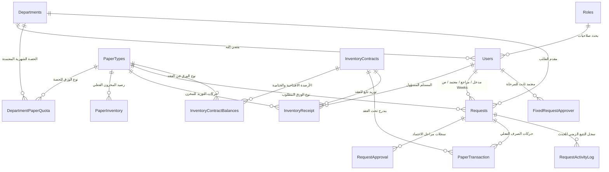

# نظام إدارة الموارد والمخزون - منظومة إدارة وتوزيع الورق (v19)
# Resource Management System (Paper Management Subsystem)

وثيقة التوثيق الفني الشاملة، المعمارية الهندسية، ودليل التشغيل والتطوير للنظام بالكامل (**الإصدار 19 - سبتمبر 2026**).

---

## 📑 فهرس المحتويات (Table of Contents)

1. [نظرة عامة على النظام (Executive Overview)](#1-نظرة-عامة-على-النظام-executive-overview)
2. [المعمارية التقنية ومكتبات العمل (Tech Stack & Architecture)](#2-المعمارية-التقنية-ومكتبات-العمل-tech-stack--architecture)
3. [هيكل المشروع والملفات (Solution Structure)](#3-هيكل-المشروع-والملفات-solution-structure)
4. [معمارية وتصميم قاعدة البيانات (Database Design & SQL Server)](#4-معمارية-وتصميم-قاعدة-البيانات-database-design--sql-server)
5. [الأدوار والمصادقة والصلاحيات (Security, Roles & Auth)](#5-الأدوار-والمصادقة-والصلاحيات-security-roles--auth)
6. [دورة حياة الطلبات ومخطط الحالات (Request Workflow State Machine)](#6-دورة-حياة-الطلبات-ومخطط-الحالات-request-workflow-state-machine)
7. [منظومة إدارة عقود المخزون (Inventory Contracts Management)](#7-منظومة-إدارة-عقود-المخزون-inventory-contracts-management)
8. [إدارة المخزن وسجلات الحركة (Inventory & Warehouse Ledger)](#8-إدارة-المخزن-وسجلات-الحركة-inventory--warehouse-ledger)
9. [إدارة الحصص والإدارات (Quotas & Department Management)](#9-إدارة-الحصص-والإدارات-quotas--department-management)
10. [دليل المسارات وواجهات الويب (Routing & Endpoint Matrix)](#10-دليل-المسارات-وواجهات-الويب-routing--endpoint-matrix)
11. [قواعد العمل والتحقق من الحالات الحدية (Business Rules & Edge Cases)](#11-قواعد-العمل-والتحقق-من-الحالات-الحدية-business-rules--edge-cases)
12. [التشغيل والبناء واستكشاف الأخطاء (Build, Run & Troubleshooting)](#12-التشغيل-والبناء-واستكشاف-الأخطاء-build-run--troubleshooting)

---

## 1. نظرة عامة على النظام (Executive Overview)

**نظام إدارة وتوزيع الورق (Paper Management Subsystem)** هو منصة مؤسسية متكاملة مصممة لإدارة وتتبع استهلاك وتوريد الورق بكافة مقاساته (مثل A4 و A3) على مستوى **48 إدارة وقطاعاً تنظيمياً**.

### الأهداف الأساسية للنظام:
- **حوكمة الاستهلاك الشهري**: ضبط حصص الإدارات الشهرية ومنع تجاوزها إلا عبر مسار طلبات استثناء مخصص ومبرر.
- **التصديق الإلكتروني متكامل المراحل**: دورة موافقات رقمية تعتمد مرحلتين قياديتين (نائب رئيس الإدارة ثم مدير الإدارة) بعد الفحص الفني من إدارة تكنولوجيا المعلومات (IT).
- **إدارة عقود التوريد والمخزون**: توثيق عقود توريد الورق بتواريخ بداية ونهاية محددة، واحتساب الأرصدة الافتتاحية والموردة والمنصرفة والختامية تلقائياً لكل عقد.
- **المنع الصارم للأخطاء وتكرار العمليات (Idempotency)**: منع تكرار إرسال الطلبات بالضغط المزدوج عبر مفاتيح فريدة (`SubmissionKey`).
- **المطابقة الآنية للأرصدة**: قفل تشاؤمي صارم في قاعدة البيانات لمنع عمليات الصرف غير المتزامنة وضمان عدم نزول الرصيد تحت الصفر مطلقاً.

---

## 2. المعمارية التقنية ومكتبات العمل (Tech Stack & Architecture)

| المكون التقني | التقنية / المواصفة | الوصف |
| :--- | :--- | :--- |
| **إطار العمل الأساسي** | **.NET 10.0 (net10.0)** | أحدث بيئة عمل LTS من مايكروسوفت (C# 13، Nullable Enabled) |
| **نمط المعمارية** | **ASP.NET Core MVC with Areas** | تقسيم النظام لمناطق وظيفية (`Areas/PaperManagement`) |
| **محرك قاعدة البيانات** | **Microsoft SQL Server 2014+** | قاعدة بيانات علائقية (`Paper Managment`) تعتمد Stored Procedures بنسبة 100% |
| **طبقة الاتصال بالبيانات** | **ADO.NET (`DbHelper.cs`)** | اتصال مباشر عبر `Microsoft.Data.SqlClient` مع كشف ذكي لنوع الأمر (`CommandType.StoredProcedure` / `CommandType.Text`) |
| **المصادقة والأمان** | **Cookie Authentication + BCrypt** | تشفير كلمات المرور بـ `BCrypt.Net-Next` مع تتبع إصدار الجلسة (`AuthenticationVersion`) لإلغاء الجلسات فورياً |
| **التحديث اللحظي (Real-time)** | **Server-Sent Events (SSE)** | وسيط إشعارات مدمج وخفيف الوزن (`QueueUpdateNotifier.cs`) لتحديث الشاشات والعدادات دون إعادة تحميل |
| **محرك تصدير Excel** | **SimpleXlsxWriter (OpenXML)** | كاتب ملفات Excel مخصص دون أي مكتبات خارجية، يدعم الاتجاه العربي من اليمين لليسار (RTL) |
| **الواجهات والتصميم** | **Tailwind CSS + Cairo Font** | تصميم عصري متجاوب بالكامل باللغة العربية (RTL) مع أيقونات Bootstrap Icons ومنتقي التواريخ Flatpickr ومخططات Chart.js |

---

## 3. هيكل المشروع والملفات (Solution Structure)

```
C:\Users\h.Fathy\Desktop\project system (paper management) v19\
│
├── README.md                                    # وثيقة التوثيق الكاملة للمشروع (هذا الملف)
├── PROJECT_HANDOVER_GUIDE.md                    # دليل التسليم الفني المرجعي
├── ScriptV19.sql                                # السكريبت الكامل لإنشاء وتحديث جداول وإجراءات قاعدة البيانات
├── Fix_SQL_Admin_Access.bat                     # سكربت صيانة وإصلاح صلاحيات مدير قاعدة البيانات
├── Test_Cases.xlsx                              # حالات الاختبار الشاملة E2E
│
└── Resource Management System/
    ├── Resource Management System.slnx          # ملف حل فيجوال ستوديو الحديث
    │
    ├── Resource Management System/              # تطبيق الويب الأساسي (.NET 10 MVC)
    │   ├── Resource Management System.csproj
    │   ├── Program.cs                           # نقطة انطلاق التطبيق، تكوين الخدمات، وحقن التبعيات
    │   ├── appsettings.json                     # نصوص الاتصال ومستويات تسجيل الأحداث
    │   │
    │   ├── Common/                              # الثوابت والمساعدات المشتركة
    │   │   ├── AppConstants.cs                  # تعريف مسميات الأدوار وحالات الطلبات
    │   │   ├── PasswordHelper.cs                # دوال تشفير وفحص كلمات المرور عبر BCrypt
    │   │   └── StatusDisplayHelper.cs           # ترجمات الحالات وألوان شارات الواجهة
    │   │
    │   ├── Data/
    │   │   └── DbHelper.cs                      # الوسيط الموحد لتنفيذ الإجراءات والاستعلامات في SQL
    │   │
    │   ├── Models/                              # نماذج البيانات و ViewModels
    │   │   ├── PaperRequestModels.cs            # نماذج الطلبات، العقود، المخزون، والتقارير
    │   │   ├── NewRequestViewModel.cs           # نماذج إدخال الطلب العادي وطلب الاستثناء
    │   │   ├── UserManagementModels.cs          # نماذج إدارة المستخدمين وتغيير كلمات المرور
    │   │   └── LoginViewModel.cs                # نموذج تسجيل الدخول
    │   │
    │   ├── Services/                            # الخدمات المساعدة المتخصصة
    │   │   ├── CookieSessionValidationEvents.cs # فحص صلاحية الجلسة وإصدار التوثيق مع كل طلب
    │   │   ├── QueueUpdateNotifier.cs           # بث إشعارات التحديث الحي عبر SSE
    │   │   └── SimpleXlsxWriter.cs              # منشئ ملفات Excel بصيغة XML أصلية داعمة لـ RTL
    │   │
    │   ├── Controllers/                         # وحدات التحكم العامة للبوابة
    │   │   ├── AccountController.cs             # الدخول، الخروج، وتغيير كلمة المرور
    │   │   ├── HomeController.cs                # الصفحة الترحيبية وتوجيه المستخدمين
    │   │   └── UserManagementController.cs      # إدارة المستخدمين، الأدوار، وإعادة ضبط المرور
    │   │
    │   ├── Areas/
    │   │   └── PaperManagement/                 # منطقة منظومة الورق (Paper Management Area)
    │   │       ├── Controllers/
    │   │       │   ├── RequestController.cs     # المحرك الرئيسي: الطلبات، العقود، المخزن، التقارير
    │   │       │   └── DepartmentManagementController.cs # إدارة حصص الإدارات وتعيين المعتمدين
    │   │       │
    │   │       └── Views/
    │   │           ├── Request/                 # صفحات العمليات والتشغيل
    │   │           │   ├── Index.cshtml                  # لوحة تحكم الإدارة وتقارير الاستهلاك العامة
    │   │           │   ├── ApproverDashboard.cshtml      # لوحة تحكم المعتمدين (نائب / مدير الإدارة)
    │   │           │   ├── Create.cshtml                 # شاشة تقديم طلب صرف ورق عادي
    │   │           │   ├── ExceptionRequest.cshtml       # شاشة تقديم طلب استثناء (عند استنفاد الحصة)
    │   │           │   ├── MyRequests.cshtml             # سجل طلبات الإدارة الخاصة
    │   │           │   ├── ReviewQueue.cshtml            # قائمة مراجعة وفحص تكنولوجيا المعلومات (IT)
    │   │           │   ├── Pending.cshtml                # قائمة اعتماد الطلبات (المعتمد 1 و 2)
    │   │           │   ├── IssueQueue.cshtml             # قائمة الصرف الفعلي وتسليم الورق بالمخزن
    │   │           │   ├── History.cshtml                # الأرشيف الشامل للطلبات المنفذة والمرفوضة
    │   │           │   ├── Inventory.cshtml              # حالة المخزون الحي، التوريد، وحساب الأرصدة
    │   │           │   ├── InventoryContracts.cshtml     # إدارة وسجل عقود التوريد وبدء/إنهاء العقود
    │   │           │   ├── InventoryMovementLog.cshtml   # السجل التفصيلي الموحد لحركة الوارد والمنصرف
    │   │           │   ├── ReceiptLog.cshtml             # سجل حركات توريد المخزن
    │   │           │   └── Reports.cshtml                # التقارير التحليلية والتصدير لـ Excel
    │   │           │
    │   │           └── Shared/                  # القوالب الجزئية والتخطيط
    │   │               ├── _PaperLayout.cshtml           # القالب الرئيسي لصفحات منظومة الورق
    │   │               ├── _ApproverDetailModal.cshtml   # نافذة فحص واعتماد / رفض الطلب للمعتمدين
    │   │               ├── _RequestDetailModal.cshtml    # نافذة تفاصيل الطلب وسجل المتابعة الزمني
    │   │               └── _DashboardConsumptionChartsPartial.cshtml # المخططات البيانية للاستهلاك
    │   │
    │   └── wwwroot/                             # الملفات الثابتة (مكتبات JS، خط Cairo، الأنماط)
    │
    └── Resource Management System.Tests/        # مشروع اختبارات الوحدة والتكامل
```

---

## 4. معمارية وتصميم قاعدة البيانات (Database Design & SQL Server)

تعتمد قاعدة البيانات (`Paper Managment`) معمارية علائقية صارمة، تضمن التكامل المرجعي وحفظ السجلات التاريخية بشكل غير قابل للحذف (Immutable Audit Trails).

### مخطط العلاقات الكيانية (Entity Relationship Diagram)



### جداول قاعدة البيانات الرئيسية:

1. **`dbo.Departments`**: جدول الـ 48 جهة وإدارة وقطاعاً، مرتبة تسلسلياً (1 إلى 48).
2. **`dbo.PaperTypes`**: أنواع الورق (A4 كود 1، A3 كود 2، إلخ) مع حد التنبيه لانخفاض الرصيد (`LowStockThreshold`).
3. **`dbo.DepartmentPaperQuota`**: الحصص الشهرية المعتمدة لكل زوج (إدارة + نوع ورق).
4. **`dbo.PaperInventory`**: الرصيد اللحظي الفعلي بالمستودع لكل نوع ورق (`CurrentStock`, `TotalReceived`).
5. **`dbo.InventoryReceipt`**: سجلات التوريد وإدخال الشحنات للمخزن وربطها التلقائي بالعقد النشط.
6. **`dbo.InventoryContracts`**: سجل عقود توريد المخزون (رقم العقد، اسم العقد، تاريخ البداية، تاريخ النهاية، حالة النشاط `IsActive`، الملاحظات، بيانات الإنشاء والإغلاق).
7. **`dbo.InventoryContractBalances`**: لقطات الأرصدة الافتتاحية والختامية لكل نوع ورق تابعة لكل عقد.
8. **`dbo.Requests`**: الطلبات المقدمة بكافة حالاتها، متضمنة مفتاح عدم التكرار (`SubmissionKey` GUID) ونوع الطلب (عادي / استثناء) وملاحظات كافة الأطراف.
9. **`dbo.PaperTransaction`**: حركات خصم وصرف الورق الفعلي للإدارات بعد الاعتماد النهائي، مرتبطة برقم العقد النشط.
10. **`dbo.RequestActivityLog`**: السجل الزمني التراكمي الدقيق لكل حدث (تقديم، فحص، اعتماد أول، اعتماد ثانٍ، إعادة توجيه، صرف، رفض).
11. **`dbo.FixedRequestApprover`**: تعيين معرفات المستخدمين المعتمدين للمرحلة 1 (نائب رئيس الإدارة) والمرحلة 2 (مدير الإدارة).
12. **`dbo.Users` & `dbo.Roles`**: المستخدمون، كلمات المرور المشفرة بـ BCrypt، إصدار جلسة التوثيق (`AuthenticationVersion`)، ودور المستخدم.
13. **`dbo.AdminAuditLog`**: سجل تتبع العمليات الإدارية الحساسة (بدء العقود، إغلاقها، تعديل الحصص، والمستخدمين).

---

## 5. الأدوار والمصادقة والصلاحيات (Security, Roles & Auth)

يدعم النظام 4 أدوار قيادية وتشغيلية واضحة:

| الدور (Role) | الوصف والصلاحيات الممنوحة | الصفحة الافتراضية بعد الدخول |
| :--- | :--- | :--- |
| **`Admin`** | مدير النظام التقني: إدارة المستخدمين، تعديل الحصص، فتح وإغلاق العقود، الاطلاع على كافة اللوحات والتقارير | `/PaperManagement/Request/Index` |
| **`IT`** | مسؤولو تكنولوجيا المعلومات وأمناء المخزن: مراجعة الطلبات، الصرف الفعلي، تسجيل الوارد، إدارة العقود، والمخزن | `/PaperManagement/Request/Index` |
| **`Approver`** | المعتمدون (المعتمد 1: نائب رئيس الإدارة / المعتمد 2: مدير الإدارة): لوحة المعتمد، اعتماد ورفض الطلبات | `/PaperManagement/Request/ApproverDashboard` |
| **`Department`** | مندوبو الإدارات والقطاعات (48 إدارة): تقديم طلبات الصرف العادية والاستثنائية، متابعة حالة الطلبات | `/PaperManagement/Request/Create` |

### مصفوفة الصلاحيات التفصيلية (Access Matrix):

```
+------------------------------------+-------+----+----------+------------+
| الشاشة / الإجراء                   | Admin | IT | Approver | Department |
+------------------------------------+-------+----+----------+------------+
| لوحة التحكم الرئيسية (Dashboard)   |   ✅  | ✅ |    ❌    |     ❌     |
| لوحة تحكم المعتمدين                |   ✅  | ❌ |    ✅    |     ❌     |
| تقديم طلب عادي (Create)            |   ✅  | ✅ |    ❌    |     ✅     |
| تقديم طلب استثناء (Exception)      |   ✅  | ✅ |    ❌    |     ✅     |
| سجل طلبات إدارتي (MyRequests)       |   ✅  | ✅ |    ❌    |     ✅     |
| طابور فحص IT (ReviewQueue)         |   ✅  | ✅ |    ❌    |     ❌     |
| طابور اعتماد الطلبات (Pending)     |   ✅  | ❌ |    ✅    |     ❌     |
| طابور الصرف والتسليم (IssueQueue)  |   ✅  | ✅ |    ❌    |     ❌     |
| إدارة المخزن والتوريد (Inventory)  |   ✅  | ✅ |    ❌    |     ❌     |
| إدارة عقود التوريد (Contracts)     |   ✅  | ✅ |    ❌    |     ❌     |
| سجل حركة المخزون (Movement Log)    |   ✅  | ✅ |    ❌    |     ❌     |
| التقارير وتصدير Excel              |   ✅  | ✅ |    ❌    |     ❌     |
| إدارة حصص الإدارات                 |   ✅  | ❌ |    ❌    |     ❌     |
| إدارة المستخدمين والحسابات         |   ✅  | ❌ |    ❌    |     ❌     |
+------------------------------------+-------+----+----------+------------+
```

---

## 6. دورة حياة الطلبات ومخطط الحالات (Request Workflow State Machine)

تمر طلبات الورق بدورة حوكمة صارمة تضمن عدم صرف أي رزمة ورق دون تصديق معتمد:

```mermaid
stateDiagram-v2
    [*] --> PendingITReview: تقديم الطلب (عادي أو استثناء)
    
    state "المرحلة الأولى: فحص IT" as ITStage {
        PendingITReview --> PendingApproverOne: موافقة IT وإحالة للاعتماد
        PendingITReview --> Rejected: رفض فني نهائي من IT
    }
    
    state "المرحلة الثانية: اعتماد نائب رئيس الإدارة" as App1Stage {
        PendingApproverOne --> PendingApproverTwo: اعتماد المعتمد 1
        PendingApproverOne --> PendingITReReview: إعادة الطلب بملاحظات إلى IT
    }
    
    state "المرحلة الثالثة: اعتماد مدير الإدارة" as App2Stage {
        PendingApproverTwo --> Approved: اعتماد نهائي من المعتمد 2
        PendingApproverTwo --> PendingITReReview: إعادة الطلب بملاحظات إلى IT
    }
    
    state "المرحلة الرابعة: مراجعة الملاحظات لدى IT" as ReReviewStage {
        PendingITReReview --> PendingApproverOne: تصويب الملاحظات وإعادة الإرسال
        PendingITReReview --> Rejected: تأكيد الرفض النهائي وإغلاق الطلب
    }
    
    state "المرحلة الخامسة: الصرف والتسليم بالمخزن" as IssueStage {
        Approved --> Issued: تسليم الورق وخصم الرصيد فعلياً
    }
    
    Issued --> [*]
    Rejected --> [*]
```

### واجهة الحالات المبسطة للإدارات (Department View):
بينما يرى مسؤولو IT والمعتمدون الحالات الدقيقة (مثل `PendingApproverTwo` أو `PendingITReReview`)، تظهر للإدارات الطالبة 4 حالات واضحة ومباشرة:
1. **قيد الانتظار**: تشمل كافة مراحل الفحص والاعتمادات.
2. **تم التصديق**: تم الاعتماد النهائي وفي انتظار توجه المندوب للاستلام من المخزن.
3. **تم الصرف**: تم تسليم الورق فعلياً وخروجه من المخزن.
4. **مرفوض**: تم رفض الطلب مع توضيح سبب الرفض المدون في السجل.

---

## 7. منظومة إدارة عقود المخزون (Inventory Contracts Management)

تعد منظومة العقود إحدى الركائز الكبرى المحدثة في **الإصدار 19**، حيث تتيح ضبط ومراقبة فترات توريد المخزون وأرصدتها:

### المميزات والقواعد المنفذة:
1. **بدء عقد توريد جديد (`sp_StartInventoryContract`)**:
   - إدخال اسم العقد، رقمه، تاريخ البداية، **وتاريخ النهاية الاختياري**.
   - أخذ لقطة فورية للرصيد الحالي بالمستودع واعتماده كرصيد افتتاحي (`OpeningStock`) للعقد لكل نوع ورق.
   - الربط التلقائي لكافة حركات التوريد والصرف التي تتم خلال سريان العقد لتنسب إليه.
   - **المرونة الزمنية المتقدمة**: إمكانية بدء عقد جديد في **نفس اليوم** الذي تم فيه إغلاق العقد السابق (`@StartDate >= EndDate`) دون أي تعطيل للعمليات.
2. **العقد النشط (`Active Contract`)**:
   - يمكن للنظام احتواء عقد نشط واحد فقط في نفس الوقت.
   - تعرض لوحة التحكم الرئيسية وشاشة المخزن بيانات العقد النشط وأرصدته ومجموع منصرفاته ونسب استهلاك الورق A4 و A3.
3. **إنهاء / إغلاق العقد (`sp_CloseInventoryContract`)**:
   - يتم تحديد تاريخ إغلاق رسمي للعقد (`EndDate`) وتدوين ملاحظة الإغلاق.
   - يقوم النظام بتجميد الرصيد الختامي الفعلي للعقد (`ClosingStock`) في تاريخ النهاية المعتمد.
   - تحويل حالة العقد إلى مغلق (`IsActive = 0`) لتجهيز النظام لبدء الدورة التعاقدية التالية.
4. **تصدير سجل العقود لـ Excel**:
   - تصدير كامل بيانات العقود التاريخية مع الأرصدة الافتتاحية، الموردة، المنصرفة، والختامية مفصلة لورق A4 و A3 والإجمالي.

---

## 8. إدارة المخزن وسجلات الحركة (Inventory & Warehouse Ledger)

- **الصرف الآمن الذري (Atomic Issuance)**:
  عند قيام مسؤول المخزن بالنقر على "صرف" في طابور الصرف، ينفذ الإجراء `sp_IssueRequest` معاملة ذرية بقفل تشاؤمي (`UPDLOCK, HOLDLOCK`) لخصم الرصيد:
  ```sql
  UPDATE dbo.PaperInventory
  SET CurrentStock = CurrentStock - @Qty,
      LastUpdated = SYSUTCDATETIME()
  WHERE PaperTypeID = @PaperTypeID AND CurrentStock >= @Qty;
  ```
  إذا كان الرصيد غير كافٍ، تُلغى العملية فوراً وتطلق رسالة خطأ صريحة.

- **سجل حركة المخزون الموحد (`/PaperManagement/Request/InventoryMovementLog`)**:
  شاشة استعلامية متقدمة تعرض كل حركة تمت على المستودع (وارد أو منصرف) مع بيان التاريخ، نوع الحركة، نوع الورق، الكمية، رقم العقد التابع له، والمسؤول عن التنفيذ.

- **تنبيهات انخفاض المخزون**:
  يظهر تنبيه بصري بارز في لوحات التحكم عند هبوط رصيد أي مقاس ورق عن الحد الأدنى المعين له (`LowStockThreshold`).

---

## 9. إدارة الحصص والإدارات (Quotas & Department Management)

- **الحصص الشهرية الثابتة**:
  لكل إدارة من الإدارات الـ 48 حصة شهرية معتمدة لكل نوع ورق (تُضبط من شاشة إدارة الحصص للمدير).
- **قاعدة حظر طلب الاستثناء إلا بعد نفاد الحصة**:
  لا يتيح النظام تقديم **طلب استثناء (Exception Request)** إلا إذا كان الرصيد المتبقي من الحصة الشهرية للإدارة لذلك النوع من الورق مساوياً تماماً للصفر (`RemainingQuota == 0`). يتم فرض هذه القاعدة في 3 طبقات:
  1. *طبقة الواجهة*: تعطيل زر الإرسال وعرض شريط تحذيري بالرصيد المتبقي.
  2. *طبقة وحدة التحكم*: فحص الرصيد وإلغاء الطلب إذا كان أكبر من الصفر.
  3. *طبقة قاعدة البيانات*: إلغاء المعاملة وإطلاق الخطأ `51043` في حال وجود رصيد متبقٍ.
- **شريط الاستهلاك ثلاثي الألوان (3-Color Stacked Bar)**:
  يعرض استهلاك الإدارات بتقسيم بصري مميز:
  - 🟢 **المنصرف من الحصة** (Used Quota)
  - 🔵 **المتبقي من الحصة** (Remaining Quota)
  - 🟠 **المنصرف كاستثناء إضافي** (Exception Issued) يتجاوز سقف الحصة الأساسي.

---

## 10. دليل المسارات وواجهات الويب (Routing & Endpoint Matrix)

| المسار (URL Route) | الوظيفة والهدف | نوع الطلب (HTTP) | الأدوار المصرح لها |
| :--- | :--- | :---: | :--- |
| `/Account/Login` | تسجيل الدخول للنظام | GET / POST | عام (Anonymous) |
| `/Account/Logout` | تسجيل الخروج وإلغاء الكوكيز | POST | الجميع (Authenticated) |
| `/Account/ChangePassword` | تغيير كلمة المرور الذاتية | GET / POST | الجميع (Authenticated) |
| `/PaperManagement/Request/Index` | لوحة تحكم الإدارة والإحصائيات الكلية | GET | `Admin`, `IT` |
| `/PaperManagement/Request/ApproverDashboard` | لوحة تحكم المعتمدين والمؤشرات | GET | `Admin`, `Approver` |
| `/PaperManagement/Request/Create` | نموذج تقديم طلب صرف عادي | GET / POST | `Admin`, `IT`, `Department` |
| `/PaperManagement/Request/ExceptionRequest` | نموذج تقديم طلب صرف استثناء | GET / POST | `Admin`, `IT`, `Department` |
| `/PaperManagement/Request/MyRequests` | سجل طلبات الجهة الخاصة | GET | `Admin`, `IT`, `Department` |
| `/PaperManagement/Request/ReviewQueue` | طابور فحص ومراجعة طلبات الـ IT | GET | `Admin`, `IT` |
| `/PaperManagement/Request/Pending` | طابور اعتماد الطلبات للمعتمدين | GET | `Admin`, `Approver` |
| `/PaperManagement/Request/IssueQueue` | طابور صرف وتسليم الورق بالمستودع | GET | `Admin`, `IT` |
| `/PaperManagement/Request/History` | الأرشيف العام للطلبات وحالاتها | GET | `Admin`, `IT` |
| `/PaperManagement/Request/Inventory` | شاشة رصيد المخزن وإضافة الوارد | GET | `Admin`, `IT` |
| `/PaperManagement/Request/InventoryContracts` | إدارة وسجل عقود المخزون | GET | `Admin`, `IT` |
| `/PaperManagement/Request/StartInventoryContract` | بدء عقد جديد واعتماد الرصيد | POST | `Admin`, `IT` |
| `/PaperManagement/Request/CloseInventoryContract` | إنهاء عقد وتجميد رصيده الختامي | POST | `Admin`, `IT` |
| `/PaperManagement/Request/ExportInventoryContractsToExcel` | تصدير سجل العقود لملف Excel | GET | `Admin`, `IT` |
| `/PaperManagement/Request/InventoryMovementLog` | سجل الحركات التفصيلية للورق | GET | `Admin`, `IT` |
| `/PaperManagement/Request/Reports` | شاشة تقارير الاستهلاك العامة | GET | `Admin`, `IT` |
| `/PaperManagement/Request/ExportToExcel` | تصدير تقارير الاستهلاك لـ Excel | GET | `Admin`, `IT` |
| `/PaperManagement/Request/LiveQueueFeed` | قناة البث الحي لتحديث الطوابير (SSE) | GET | الجميع (Authenticated) |
| `/PaperManagement/DepartmentManagement` | إدارة حصص الإدارات وتعيين المعتمدين | GET / POST | `Admin` |
| `/UserManagement` | إدارة حسابات المستخدمين وصلاحياتهم | GET / POST | `Admin` |

---

## 11. قواعد العمل والتحقق من الحالات الحدية (Business Rules & Edge Cases)

1. **التعامل الذكي مع أوامر قاعدة البيانات في `DbHelper.cs`**:
   - تم ضبط دالة فحص الأمر تلقائياً (`GetCommandType`) لتمييز ما إذا كان النص المرسل اسماً لإجراء مخزن (`StoredProcedure`) أو استعلاماً نصياً (`Text`) يحتوي فراغات أو أسطراً جديدة، مما يمنع حدوث استثناء تجاوز طول اسم الإجراء (`CommandText exceeds limit of 1046`).
2. **منع التكرار وحماية الإرسال المزدوج (`@SubmissionKey`)**:
   - يتم توليد GUID فريد مع كل نموذج طلب ويُفحص داخل المعاملة بقفل تشاؤمي لمنع إنشاء طلب مكرر عند النقر السريع المتعدد.
3. **توقيت القاهرة والتخزين بالـ UTC**:
   - كافة التواريخ تُخزن في قاعدة البيانات بصيغة UTC الصافية (`SYSUTCDATETIME()`).
   - عند العرض والتحقق، يتم التحويل لتوقيت مصر عبر الدالة البرمجية `ToEgyptTime()` ودالة SQL المسماة `dbo.fn_EgyptUtcToLocal`.
4. **شروط استمرارية العقود**:
   - لا يمكن أن يكون تاريخ نهاية العقد قبل تاريخ بدايته.
   - لا يمكن بدء عقد بتاريخ يسبق تاريخ نهاية العقود السابقة.
   - يُسمح ببدء العقد الجديد في نفس يوم انتهاء العقد السابق لضمان استمرارية العمل دون انقطاع.

---

## 12. التشغيل والبناء واستكشاف الأخطاء (Build, Run & Troubleshooting)

### المتطلبات الأساسية للتشغيل:
- حزمة تطوير **.NET 10.0 SDK** مثبتة على الجهاز.
- محرك **Microsoft SQL Server 2014** أو أحدث.
- قاعدة بيانات باسم `Paper Managment` منفذ عليها ملف `ScriptV19.sql`.

### أوامر PowerShell الأساسية:

#### 1. إنهاء العمليات العالقة وتفريغ الملفات المقفلة:
```powershell
Stop-Process -Name "Resource Management System", "dotnet", "iisexpress" -Force -ErrorAction SilentlyContinue
```

#### 2. التحقق من سلامة البناء البرمجي (Build):
```powershell
dotnet build "C:\Users\h.Fathy\Desktop\project system (paper management) v19\Resource Management System\Resource Management System\Resource Management System.csproj"
```

#### 3. تشغيل التطبيق في بيئة التطوير المحلية:
```powershell
dotnet run --project "C:\Users\h.Fathy\Desktop\project system (paper management) v19\Resource Management System\Resource Management System\Resource Management System.csproj"
```
- الروابط المحلية الافتراضية:  
  `https://localhost:7107`  
  `http://localhost:5249`

#### 4. فحص اتصال قاعدة البيانات من PowerShell:
```powershell
$connStr = "Server=.;Database=Paper Managment;Trusted_Connection=True;TrustServerCertificate=True;Encrypt=False;"
$conn = New-Object Microsoft.Data.SqlClient.SqlConnection($connStr)
$conn.Open()
$cmd = $conn.CreateCommand()
$cmd.CommandText = "SELECT COUNT(*) FROM dbo.Departments"
$count = $cmd.ExecuteScalar()
Write-Output "الاتصال بقاعدة البيانات سليم! إجمالي الإدارات: $count"
$conn.Close()
```

---

> **ملاحظة للمطورين**: تم إعداد هذا الملف ليكون المرجع الفني الشامل لكامل معمارية وشفرات وقواعد بيانات نظام إدارة الموارد (الإصدار 19)، وهو جاهز للاستخدام كدليل تسليم أو سياق متكامل لأي جلسة تطوير مستقبلية.